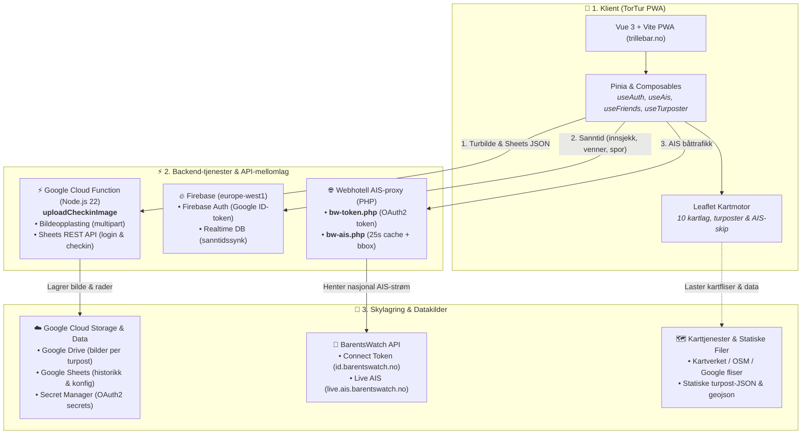
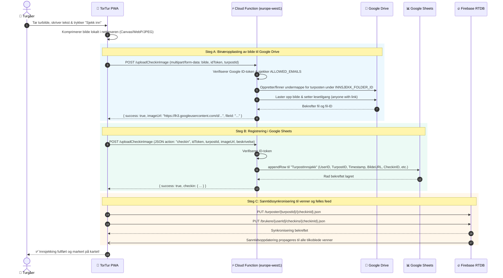
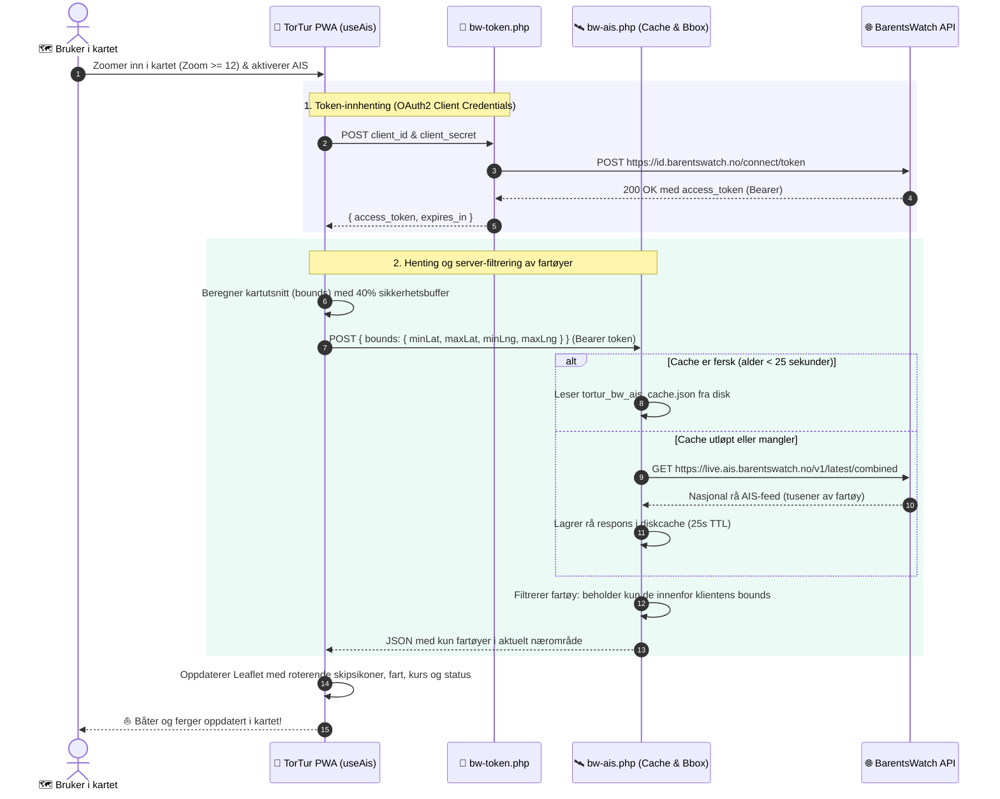

# 🏛️ TorTur – Systemarkitektur og Dataflyt

Dette dokumentet beskriver den overordnede tekniske arkitekturen i **TorTur**, hvordan komponentene henger sammen, og hvordan data, sanntidssynkronisering og sikkerhet håndteres mellom frontend, skytjenester og støtte-backends slik systemet er i drift i dag.

---

## 🗺️ 1. Helhetlig Systemarkitektur

Følgende diagram viser kjernekomponentene i TorTur-økosystemet i dag:



---

## 🔄 2. Dataflyt ved Innsjekking med Bilde

Innsjekkingsprosessen er optimalisert for minimal nettverksbelastning, sikker lagring av bilder og regnearkdata i Google Cloud, samt umiddelbar sanntidsvarsling til venner via Firebase:



---

## 🚢 3. Dataflyt for BarentsWatch AIS (Sanntids Båttrafikk)

For å vise levende skips- og fergetrafikk langs norskekysten uten å utsette klienten for overveldende datamengder eller CORS-problemer, benyttes to lette PHP-proxier på webhotellet:



---

## 🔐 4. Sikkerhetsmodell og Nøkkelhåndtering

| Komponent                      | Sikkerhetsmekanisme                | Beskrivelse                                                                                                                                                                                                                                                                                                                                           |
| ------------------------------ | ---------------------------------- | ----------------------------------------------------------------------------------------------------------------------------------------------------------------------------------------------------------------------------------------------------------------------------------------------------------------------------------------------------- |
| **Google Cloud Function**      | **Google Secret Manager & ADC**    | Kjører under en dedikert Google Service Account med rollen `Secret Manager Secret Accessor`. Henter OAuth2 Refresh Token for Google Drive ved behov og benytter Application Default Credentials (ADC) for Google Sheets API. Verifiserer innkommende `idToken` via `google-auth-library` og begrenser tilgang via `ALLOWED_EMAILS`.                   |
| **Google Drive**               | **Strukturert tilgangsstyring**    | Bildene lagres i undermapper per turpost under en fast hovedmappe (`INNSJEKK_FOLDER_ID`). Cloud Function setter leserettighet for alle med lenken (`anyone with link`), slik at bildene kan vises i PWA-en uten å eksponere skrive- eller slettetilgang.                                                                                              |
| **Google Sheets**              | **Skjermet databaselag**           | Ingen direkte tilgang fra nettleseren. All lesing og skriving skjer via Cloud Function.                                                                                                                                                                                                                                                               |
| **Webklient (PWA)**            | **Google Identity Services (GIS)** | Bruker logger inn med offisiell Google OAuth2. `id_token` lagres i `sessionStorage` og benyttes som bærer-token mot både Cloud Function og Firebase Authentication.                                                                                                                                                                                   |
| **Firebase Realtime Database** | **Firebase Security Rules**        | Regelsett i [database.rules.json](file:///Users/mala/work/github/tortur/database.rules.json) sikrer at kun autentiserte brukere (`auth != null`) kan lese felles turpostinnsjekkinger og skrive til sine egne brukernoder (`/brukere/{userId}/...`).                                                                                                  |
| **BarentsWatch Proxier (PHP)** | **Server-side Proxy & Caching**    | [bw-token.php](file:///Users/mala/work/github/tortur/public/api/bw-token.php) og [bw-ais.php](file:///Users/mala/work/github/tortur/public/api/bw-ais.php) kjører på webhotellet. De hindrer CORS-problemer, holder hemmeligheter unna tredjeparter, og beskytter BarentsWatch API-et mot overbelastning gjennom en 25-sekunders felles server-cache. |

---

## 📁 5. Komponentstruktur og Filer

Oversikt over systemets faktiske struktur i dag:

```
tortur/
├── src/
│   ├── composables/
│   │   ├── useAuth.ts               # Hovedcomposable: Google-innlogging, innsjekk, Cloud Function API
│   │   ├── useAis.ts                # BarentsWatch AIS: båtsporing, bufferberegning og proxy-kall
│   │   ├── useFriends.ts            # Venneforespørsler, vennefeed og profilsynk i Firebase
│   │   ├── useTurposter.ts          # Turpostdata, fylker, kommuner og hierarkisk navigasjon
│   │   ├── useGeolocation.ts        # Enhetens GPS-posisjon og "Følg meg"-sporing
│   │   ├── useGeoDetect.ts          # Automatisk deteksjon av nærliggende turposter
│   │   ├── useCheckinSocial.ts      # Sosiale reaksjoner (likes/emojis) og kommentarer
│   │   ├── useFirebaseTracks.ts     # Lagring og deling av GPS-spor i Firebase
│   │   ├── usePrivateTurposter.ts   # Brukerdefinerte turposter ("Mine steder")
│   │   ├── useTrackPhotos.ts        # Geotaggede turbilder koblet mot GPS-ruter
│   │   └── useAppUpdate.ts          # PWA Service Worker oppdateringsvarsler
│   ├── components/
│   │   ├── MapViewer.vue            # Leaflet kartflate, lagvelgere, turpost-markører og AIS-skip
│   │   ├── CheckinModal.vue         # Innsjekkingsdialog med bildekomprimering og kamera
│   │   ├── CheckinSocialSection.vue # Likes og kommentarer på innsjekkinger
│   │   ├── TurposterPanel.vue       # Fylkes- og kommunevelger med søk og filter
│   │   ├── FriendsModal.vue         # Venneliste, søk og venneforespørsler
│   │   ├── GpsTrackModal.vue        # Opptak, import og visning av GPX-spor
│   │   └── UserProfileModal.vue     # Brukerprofil og personlig turstatistikk
│   ├── services/
│   │   └── firebase.ts              # Firebase App, Auth og Realtime Database initialisering
│   ├── stores/
│   │   ├── appState.ts              # Global applikasjonstilstand (modaler, paneler)
│   │   └── gpsTrack.ts              # Aktivt GPS-spor, høydeprofil og avspillingstilstand
│   └── utils/
│       ├── imageCompression.ts      # Klientside bildekomprimering før opplasting
│       ├── gpxParser.ts             # Parsing av GPX/GeoJSON-filer til kartruter
│       ├── mapIcons.ts              # Egendefinerte Leaflet DivIcon markører
│       └── mapTileLayers.ts         # Konfigurasjon av de 10 kartlagene
├── scripts/
│   ├── drive-upload-function/       # Google Cloud Function (Node.js v22)
│   │   ├── src/
│   │   │   ├── index.js             # HTTP-endepunkt for multipart-opplasting og JSON API
│   │   │   ├── auth.js              # Google Secret Manager og OAuth2/Service Account auth
│   │   │   ├── driveService.js      # Google Drive v3 API (mappeadministrasjon & opplasting)
│   │   │   └── sheetsService.js     # Google Sheets API (login, checkin, update, delete, config)
│   │   ├── deploy.sh                # Distribusjonsskript for Cloud Function
│   │   └── package.json             # Node.js 22 avhengigheter (busboy, googleapis, etc.)
│   └── build-data.js                # Byggeskript: genererer turpost-JSON per kommune fra CSV
├── public/
│   ├── api/                         # PHP-proxy som kjører på webhotellet
│   │   ├── bw-token.php             # BarentsWatch OAuth2 Token proxy
│   │   └── bw-ais.php               # BarentsWatch AIS proxy med 25s diskcache og bounding box-filter
│   └── data/                        # Statisk generert datagrunnlag for PWA
│       ├── hierarchy.json           # Oversikt over fylker, kommuner og antall turposter
│       ├── kommuner.geojson         # Kartverkets kommunegrenser
│       └── turposter/               # Individuelle JSON-filer per kommune
└── database.rules.json              # Sikkerhetsregler for Firebase Realtime Database
```

---

## 💡 6. Hvorfor denne arkitekturen?

1. **Skalerbar serverless backend i skyen**:
   - Google Cloud Function (gen 2, Node.js 22) håndterer både bildeopplasting til Google Drive og databasetransaksjoner mot Google Sheets.
   - Den starter på få hundre millisekunder (Bortsett ved start fra ColdStart som kan ta noen sekunder, men det er bevisst ikke lagt inn mekanisme for å forhindre ColdStart da dette koster noen dollar per måned)
2. **Minimal belastning på webhotell og mobilbåndbredde**:
   - Rå binær bildeopplasting via `multipart/form-data` direkte til Google Cloud Function.
   - Webhotellet leverer primært statiske PWA-ressurser og de to lette PHP-proxyene for BarentsWatch.
3. **Smart AIS-optimalisering for mobilnett**:
   - BarentsWatch sender tusenvis av fartøy i den nasjonale sanntidsstrømmen.
   - [bw-ais.php](file:///Users/mala/work/github/tortur/public/api/bw-ais.php) cacher denne strømmen på webhotellet i 25 sekunder og filtrerer bort alle båter utenfor brukerens kartutsnitt før svaret returneres. Dette reduserer datastørrelsen fra flere megabyte til få kilobyte per oppdatering.
4. **Hybrid datamodell (Permanent historikk + lynrask sanntid)**:
   - **Google Sheets**: Fungerer som en tilgjengelig, reviderbar og eksporterbar master-database for brukere, innsjekkingshistorikk og konfigurasjon.
   - **Firebase Realtime Database**: Leverer umiddelbar toveis synkronisering (sub-sekund) for sosiale interaksjoner, venneoppdateringer, kommentarer, likes og GPS-spor.
5. **Robust offline- og PWA-opplevelse**:
   - Turpostdata er delt inn i lette JSON-filer per kommune og caches av Service Worker, slik at appen fungerer selv i områder med dårlig eller fraværende mobildekning.
