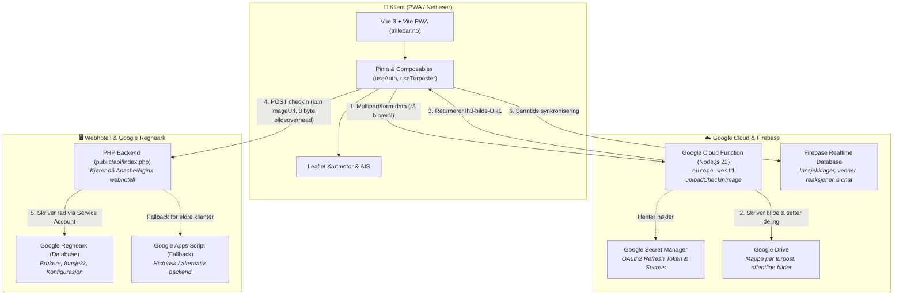
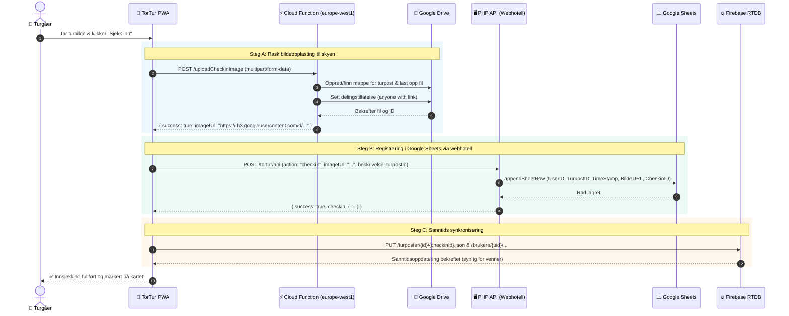

# 🏛️ TorTur – Systemarkitektur og Dataflyt

Dette dokumentet beskriver den overordnede tekniske arkitekturen i **TorTur**, hvordan komponentene henger sammen, og hvordan data og sikkerhet håndteres mellom frontend, skytjenester og backends.

---

## 🗺️ 1. Helhetlig Systemarkitektur

Følgende diagram viser alle kjernekomponenter i TorTur-økosystemet:



---

## 🔄 2. Dataflyt ved Innsjekking med Bilde

Innsjekkingsprosessen er designet for maksimal hastighet, minimal overføring av tunge data over webhotellet, og umiddelbar sanntidsoppdatering for andre brukere:



---

## 🔐 3. Sikkerhetsmodell og Nøkkelhåndtering

| Komponent | Sikkerhetsmekanisme | Beskrivelse |
|---|---|---|
| **Google Cloud Function** | **Google Secret Manager** | Kjører under dedikert Service Account med rollen `Secret Manager Secret Accessor`. Henter OAuth2 Refresh Token ved oppstart og opererer som Drive-eieren for å skrive til `INNSJEKK_FOLDER_ID`. |
| **PHP Backend (Webhotell)** | **Google Service Account JSON** | Skriver til Google Sheets via direkte Google API-kall (JWT service account). Nøkkelfilen ligger utenfor offentlig webroot (`service-account.json`). |
| **Webklient (PWA)** | **Google Identity Services (GIS)** | Innlogging skjer via offisiell Google OAuth2 ID-token (`id_token`), som verifiseres av backend og benyttes for autentisering mot Firebase. |
| **Firebase Realtime Database** | **Firebase Security Rules** | Regelsett i `database.rules.json` sikrer at kun innloggede brukere kan skrive til sine egne mapper og oppdatere innsjekkinger/vennelister. |

---

## 📁 4. Komponentstruktur og Filer

```
tortur/
├── src/
│   ├── composables/
│   │   ├── useAuth.ts            # Hovedcomposable: innlogging, innsjekking, Cloud Function opplasting
│   │   ├── useGeolocation.ts     # Posisjonering og "Følg meg"-sporing
│   │   └── useTurposter.ts       # Turpostdata, hierarki og kommunelister
│   ├── components/
│   │   ├── MapViewer.vue         # Leaflet-kart, lagvelger, markører og AIS-skip
│   │   ├── CheckinModal.vue      # Innsjekkingsdialog med bildevelger og kamera
│   │   └── TurposterPanel.vue    # Søk og filtrering per fylke/kommune
│   └── services/
│       └── firebase.ts           # Firebase SDK og Sanntids-database
├── scripts/
│   ├── drive-upload-function/    # Google Cloud Function (Node.js 22)
│   │   ├── src/
│   │   │   ├── index.js          # HTTP-endepunkt for multipart-opplasting
│   │   │   ├── auth.js           # Secret Manager og OAuth2-klient
│   │   │   └── driveService.js   # Google Drive v3 API-håndtering
│   │   ├── test/                 # Frittstående testsider (upload.html)
│   │   ├── deploy.sh             # Ett-klikks deploy-skript for europe-west1
│   │   └── package.json          # Node.js 22 avhengigheter
│   ├── appscript/
│   │   └── appscript.js          # Google Apps Script (alternativ/historisk backend v15)
│   └── build-data.js             # Byggeskript for turpost-JSON fra CSV
└── public/
    └── api/                      # PHP Backend for webhotell
        ├── index.php             # Google Sheets API-integrasjon
        └── GoogleClient.php      # Lettvekts Google REST-klient for PHP
```

---

## 💡 5. Hvorfor denne arkitekturen?

1. **Null belastning på webhotellet**: Webhotellet har ofte strenge grenser for opplastingsstørrelse og båndbredde. Ved å rute bildet direkte til Google Cloud Function via `multipart/form-data`, berører bildefilene aldri webhotellets PHP-prosess.
2. **Lynrask oppstart (ingen Apps Script cold-start)**: Google Cloud Function (gen 2) på Node.js 22 starter på få hundre millisekunder, i motsetning til Apps Script som ofte har flere sekunders forsinkelse.
3. **Ingen Base64-overhead**: Rå binærfiloverføring reduserer datamengden med over 33 % sammenlignet med tradisjonell Base64-koding over mobilnettet.
4. **Feiltolerant (Fallback)**: Dersom Cloud Function mot formodning ikke er tilgjengelig, faller klienten automatisk tilbake til Base64-opplasting mot PHP/Apps Script.
