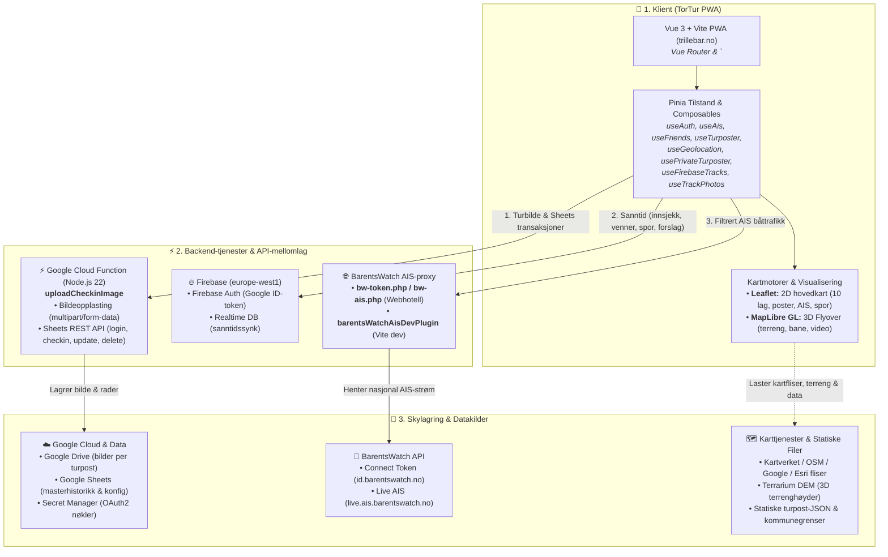
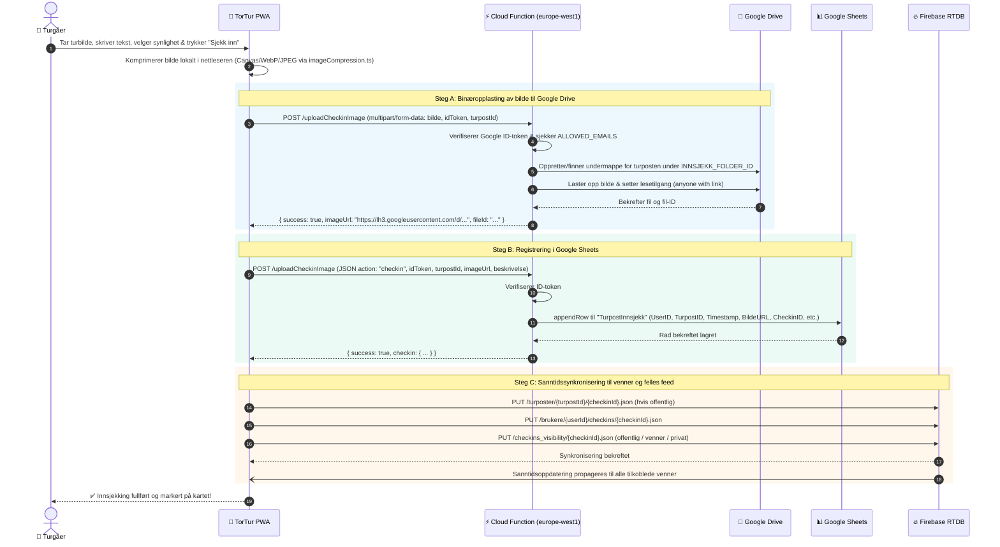
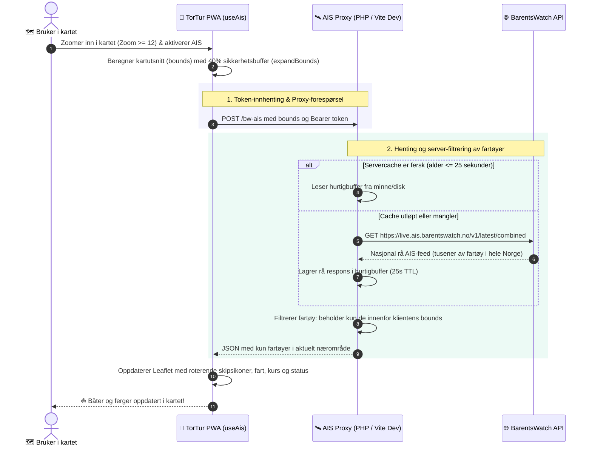
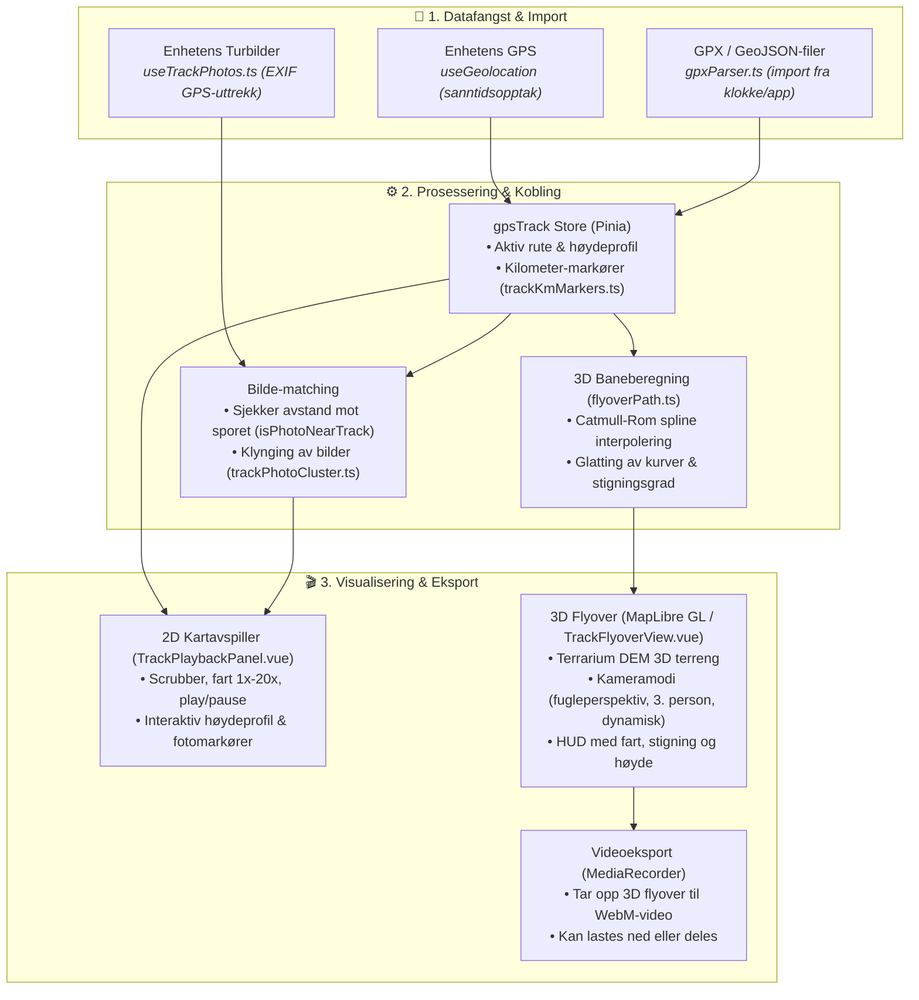

# 🏛️ TorTur – Systemarkitektur og Dataflyt

Dette dokumentet beskriver den overordnede tekniske arkitekturen i **TorTur**, hvordan komponentene henger sammen, og hvordan data, sanntidssynkronisering, 3D-visualisering og sikkerhet håndteres mellom frontend, skytjenester og støtte-backends slik systemet er i drift i dag.

---

## 🗺️ 1. Helhetlig Systemarkitektur

Følgende diagram viser kjernekomponentene i TorTur-økosystemet i dag:



---

## 🔄 2. Dataflyt ved Innsjekking med Bilde

Innsjekkingsprosessen er optimalisert for minimal nettverksbelastning, sikker lagring av bilder og regnearkdata i Google Cloud, samt umiddelbar sanntidsvarsling til venner via Firebase:



---

## 🚢 3. Dataflyt for BarentsWatch AIS (Sanntids Båttrafikk)

For å vise levende skips- og fergetrafikk langs norskekysten uten å utsette mobilklienten for overveldende datamengder eller CORS-problemer, benyttes en server-side proxy med diskcache og geografisk avgrensning:



---

## 🚁 4. GPS-spor, Geotaggede Turbilder og 3D Flyover

TorTur har et komplett økosystem for innspilling, lagring, berikelse og visualisering av turer:



### Kjernekomponenter i 3D Flyover-motoren:

1. **Catmull-Rom Spline-interpolering (`flyoverPath.ts`)**:
   - Rå GPS-punkter kan ha varierende tidsintervaller og mikrobevegelser.
   - Algoritmen resampler og jevner ut sporet med jevne avstander (f.eks. hver 8. meter) og beregner tangentvektorer for kurs (bearing), helling (pitch) og stigningsgradient.
2. **MapLibre GL & 3D Terreng (`useFlyoverMap.ts`, `flyoverTileSources.ts`)**:
   - Benytter Terrarium/Mapzen raster-DEM (Digital Elevation Model) for å bygge et fotorealistisk 3D-terreng.
   - Kombinerer dette med høyoppløselige satellitt- eller topografiske kartfliser.
3. **Kamerakontroller (`useFlyoverCamera.ts`)**:
   - Støtter tre moduser: **Fugleperspektiv** (oversikt ovenfra), **Tredjeperson** (plassert bak/over turgåeren i fartsretningen) og **Dynamisk** (varierer vinkel og avstand etter terreng og svinger).
4. **Synkronisert HUD og Avspiller (`useFlyoverPlayback.ts`, `FlyoverHud.vue`)**:
   - Styres av `requestAnimationFrame` med `performance.now()` for stabil bildefrekvens.
   - Viser sanntids høyde over havet, stigningsprosent, fart, distanse og fremdrift langs høydeprofilen.
5. **Innebygd Videoopptak**:
   - Tar opp MapLibre-lerretet direkte til WebM-videofil via nettleserens `MediaRecorder`-API.

---

## 📍 5. Private Turposter og Forslagssystem

For å utvide kartet utover de 15 200 faste turpostene fra postkassetrimmen, tilbyr systemet to parallelle spor:

1. **Private Turposter («Mine steder» / `usePrivateTurposter.ts`)**:
   - Opprettes enkelt ved å holde fingeren nede på kartet (langtrykk) eller høyreklikke med musen.
   - Lagres under brukerens private node i Firebase: `/<prefix>/brukere/{userId}/my_spots/{spotId}.json`.
   - Kun synlige for den innloggede brukeren via strenge Firebase-sikkerhetsregler.
   - Brukeren kan sjekke inn på egne private turposter med bilder og notater.
2. **Forslag til Offentlige Turposter (`/forslag` / `SpotSuggestionsView.vue`)**:
   - Brukere kan foreslå nye poster til felleskartet.
   - **Automatisk plassering i CSV**: Systemet analyserer eksisterende `mountains.csv` og beregner nøyaktig linjenummer der posten hører hjemme alfabetisk under riktig kommune (`CsvPlacementResult`).
   - Forslag lagres i `/<prefix>/spot_suggestions/{id}.json` med status `pending`.
   - Administratorer kan godkjenne eller avvise forslag direkte i appen:
     - **Godkjenning**: Posten lagres i `/<prefix>/approved_spots/{id}.json` og vises umiddelbart for alle innloggede brukere på kartet som offentlig turpost. Innsenderens egen oppføring oppdateres automatisk til status `approved` med «Godkjent av admin»-badge.
     - **Avvisning**: Forslaget merkes som `denied` og oppdaterer brukerens oppføring til «Avvist».
   - **Eksport til `mountains.csv`**:
     - Kjøres med `npm run sync:spots`. Skriptet henter ueksporterte godkjente turposter fra `approved_spots`, fletter dem alfabetisk inn i `data/mountains.csv`, og markerer dem som `status: 'exported'` (`exportedToCsv: true`).
     - Deretter kjøres `npm run build` (som regenererer JSON-filer og hierarki) før manuell publisering.

---

## 🔐 6. Sikkerhetsmodell og Nøkkelhåndtering

| Komponent | Sikkerhetsmekanisme | Beskrivelse |
|---|---|---|
| **Google Cloud Function** | **Secret Manager & ADC** | Kjører under en dedikert Google Service Account med rollen `Secret Manager Secret Accessor`. Henter OAuth2 Refresh Token for Google Drive ved behov og benytter Application Default Credentials (ADC) for Google Sheets API. Verifiserer innkommende `idToken` via `google-auth-library` og begrenser tilgang via `ALLOWED_EMAILS`. |
| **Google Drive** | **Strukturert tilgangsstyring** | Bildene lagres i undermapper per turpost under en fast hovedmappe (`INNSJEKK_FOLDER_ID`). Cloud Function setter leserettighet for alle med lenken (`anyone with link`), slik at bildene kan vises i PWA-en uten å eksponere skrive- eller slettetilgang. |
| **Google Sheets** | **Skjermet databaselag** | Ingen direkte tilgang fra nettleseren. All lesing og skriving skjer via Cloud Function. |
| **Webklient (PWA)** | **Google Identity Services (GIS)** | Bruker logger inn med offisiell Google OAuth2. `id_token` lagres i `sessionStorage` og benyttes som bærer-token mot både Cloud Function og Firebase Authentication. |
| **Firebase Realtime Database** | **Finkornet regelsett** | Regelsett i [database.rules.json](file:///Users/mala/work/github/tortur/database.rules.json) sikrer: <br/>• Autentiserte brukere kan lese felles turposter, godkjente turposter (`approved_spots`) og skrive likes/kommentarer.<br/>• Brukerspesifikke data (`checkins`, `my_spots`, `tracks`, `track_photos`) er låst til brukerens egen `auth.uid`.<br/>• Innsjekkinger og spor deles selektivt med godkjente venner basert på vennelister.<br/>• Forslag til turposter (`spot_suggestions`) er skjermet, og kun administratorer har skrivetilgang til `approved_spots` via `admins`-noden. |
| **BarentsWatch Proxier** | **Server-side Proxy & Caching** | Produksjon: [bw-token.php](file:///Users/mala/work/github/tortur/public/api/bw-token.php) og [bw-ais.php](file:///Users/mala/work/github/tortur/public/api/bw-ais.php) på webhotell hindrer CORS-problemer og beskytter API-et via 25s diskcache og bounding box-filter.<br/>Utvikling: `barentsWatchAisDevPlugin` i [vite.config.ts](file:///Users/mala/work/github/tortur/vite.config.ts) gir samme opplevelse lokalt. |

---

## 📁 7. Komponent- og Katalogstruktur

Oversikt over systemets oppbygning:

```
tortur/
├── src/
│   ├── App.vue                      # Rotkomponent med Vue Router <RouterView />
│   ├── main.ts                      # App-initialisering (Vue, Pinia, Router)
│   ├── types.ts                     # Sentrale TypeScript-domenetypedefinisjoner
│   ├── router/
│   │   └── index.ts                 # Vue Router: ruter for kart, profil, venner, spor, 3D
│   ├── views/
│   │   ├── MapView.vue              # Hovedvisning: 2D Leaflet-kart, lag, kontroller, AIS
│   │   ├── ProfileView.vue          # Brukerprofil og innsjekkingshistorikk
│   │   ├── FriendsView.vue          # Venneliste, søk og venneforespørsler
│   │   ├── FriendProfileView.vue    # Visning av en venns profil og turer
│   │   ├── MySpotsView.vue          # Administrasjon av egne private turposter
│   │   ├── GpsTracksView.vue        # Bibliotek over lagrede GPS-spor
│   │   ├── SpotSuggestionsView.vue  # Administrasjon av turpost-forslag
│   │   └── TrackFlyoverView.vue     # 3D Flyover-visning med MapLibre GL og videoopptak
│   ├── components/
│   │   ├── MapViewer.vue            # Leaflet kartflate, markører og hendelseshåndtering
│   │   ├── MapContextMenu.vue       # Kontekstmeny ved langtrykk/høyreklikk i kartet
│   │   ├── MapLayerButton.vue       # Hurtigknapp for valg av kartlag
│   │   ├── AppHeader.vue            # Hovedheader med status, innlogging og meny
│   │   ├── LocationControls.vue     # GPS-posisjonsknapp og «Følg meg»-indikator
│   │   ├── TurposterPanel.vue       # Fylkes- og kommunevelger med søk og filter
│   │   ├── TurpostCheckinsModal.vue # Alle innsjekkinger på en valgt turpost
│   │   ├── CheckinModal.vue         # Innsjekkingsdialog med bildekomprimering
│   │   ├── EditCheckinModal.vue     # Redigering og sletting av egne innsjekkinger
│   │   ├── CheckinSocialSection.vue # Likes (emojis) og kommentarer på innsjekkinger
│   │   ├── AddTurpostModal.vue      # Dialog for å legge til privat post eller forslag
│   │   ├── TrackPlaybackPanel.vue   # 2D GPS-spor avspiller med høydeprofil
│   │   ├── TrackPhotosSection.vue   # Geotaggede turbilder koblet mot GPS-rute
│   │   ├── GpsTrackModal.vue        # Opptak, import og administrasjon av GPS-spor
│   │   ├── checkin/                 # Modulære innsjekkingskomponenter (WebcamCapture, etc.)
│   │   ├── flyover/                 # 3D Flyover-komponenter:
│   │   │   ├── FlyoverMap.vue       # MapLibre GL 3D lerret
│   │   │   ├── FlyoverControls.vue  # Avspillingskontroller, fart og kameramodi
│   │   │   ├── FlyoverHud.vue       # Sanntids HUD (høyde, fart, stigning, tid)
│   │   │   └── ElevationProfile.vue # Interaktiv høydeprofil med markør
│   │   ├── friends/                 # Modulære vennefaner (lister, søk, forespørsler)
│   │   ├── header/                  # Modulære header-elementer (AisInfoModal, etc.)
│   │   └── profile/                 # Profilkomponenter og innsjekkingskort
│   ├── composables/
│   │   ├── useAuth.ts               # Google OAuth2, innsjekk, Cloud Function API
│   │   ├── useAis.ts                # BarentsWatch AIS: båtsporing, buffer og proxy
│   │   ├── useFriends.ts            # Venneforespørsler, vennefeed og profilsynk
│   │   ├── useTurposter.ts          # Turpostdata, fylker, kommuner og hierarki
│   │   ├── useGeolocation.ts        # Enhetens GPS-posisjon og «Følg meg»-sporing
│   │   ├── useGeoDetect.ts          # Automatisk kommune- og utlandsdeteksjon
│   │   ├── useCheckinSocial.ts      # Emoji-reaksjoner og kommentarer i Firebase
│   │   ├── usePrivateTurposter.ts   # Private turposter («Mine steder») og forslag
│   │   ├── useFirebaseTracks.ts     # Lagring og deling av GPS-spor i Firebase
│   │   ├── useTrackPhotos.ts        # EXIF GPS-uttrekk og kobling av bilder til ruter
│   │   ├── useAppUpdate.ts          # PWA Service Worker oppdateringsvarsler
│   │   ├── map/                     # Kart-composables:
│   │   │   ├── useMapAisLayer.ts    # AIS båtlag med roterende ikoner
│   │   │   ├── useMapLongpress.ts   # Langtrykk- og høyreklikksdeteksjon
│   │   │   ├── useMapMunicipalitiesLayer.ts # GeoJSON kommunegrenser
│   │   │   └── useMapTrackLayer.ts  # GPS-sporalag og kilometer-markører
│   │   └── flyover/                 # 3D Flyover-composables:
│   │       ├── useFlyoverMap.ts     # MapLibre GL initialisering og terreng
│   │       ├── useFlyoverCamera.ts  # Kamerabevegelser og moduser
│   │       └── useFlyoverPlayback.ts # requestAnimationFrame avspillingsløkke
│   ├── stores/
│   │   ├── appState.ts              # Global applikasjonstilstand og modaler
│   │   └── gpsTrack.ts              # Aktivt GPS-spor, høydeprofil og tilstand
│   ├── config/
│   │   └── mapLayers.ts             # Definisjon av de 10 kartlagene og rettigheter
│   └── utils/
│       ├── flyoverPath.ts           # Catmull-Rom spline, sampling og kurveglatting
│       ├── flyoverTileSources.ts    # 3D terreng- og flisekilder (Terrarium DEM)
│       ├── gpxParser.ts             # GPX/GeoJSON-parsing til GPS-punkter
│       ├── imageCompression.ts      # Klientside bildekomprimering før opplasting
│       ├── mapIcons.ts              # Egendefinerte Leaflet DivIcon markører
│       ├── mapTileLayers.ts         # TileLayer-oppsett for Leaflet
│       ├── trackKmMarkers.ts        # Kilometer-markører langs spor
│       ├── trackPhotoCluster.ts     # Klynging av turbilder langs ruter
│       └── trackPlayback.ts         # 2D GPS-spor avspillingslogikk
├── scripts/
│   ├── drive-upload-function/       # Google Cloud Function (Node.js v22)
│   │   ├── src/
│   │   │   ├── index.js             # HTTP-endepunkt for multipart og JSON API
│   │   │   ├── auth.js              # Secret Manager og Google Service Account auth
│   │   │   ├── driveService.js      # Google Drive v3 API (mapper & opplasting)
│   │   │   └── sheetsService.js     # Google Sheets API (login, checkin, update, delete)
│   │   ├── deploy.sh                # Distribusjonsskript for Cloud Function
│   │   └── package.json             # Node.js 22 avhengigheter
│   └── build-data.js                # Genererer turpost-JSON per kommune fra CSV
├── public/
│   ├── api/                         # PHP-proxier for webhotell i produksjon
│   │   ├── bw-token.php             # BarentsWatch OAuth2 Token proxy
│   │   └── bw-ais.php               # BarentsWatch AIS proxy med 25s cache og bbox
│   └── data/                        # Statisk generert datagrunnlag for PWA
│       ├── hierarchy.json           # Oversikt over fylker, kommuner og post-antall
│       ├── kommuner.geojson         # Kartverkets kommunegrenser
│       └── turposter/               # Individuelle JSON-filer per kommune
├── vite.config.ts                   # Vite-konfig, PWA-oppsett og lokal AIS Dev Plugin
└── database.rules.json              # Sikkerhetsregler for Firebase Realtime Database
```

---

## 💡 8. Hvorfor denne arkitekturen?

1. **Skalerbar serverless backend i skyen**:
   - Google Cloud Function (gen 2, Node.js 22) håndterer både rå bildeopplasting til Google Drive og databasetransaksjoner mot Google Sheets uten behov for egne servere som krever vedlikehold.
2. **Minimal belastning på mobilbåndbredde**:
   - Bildene komprimeres lokalt i nettleseren før opplasting.
   - Webhotellet leverer primært statiske ressurser og en lett mellomlagret AIS-proxy.
3. **Smart AIS-optimalisering**:
   - Både i produksjon (PHP) og under lokal utvikling ([vite.config.ts](file:///Users/mala/work/github/tortur/vite.config.ts)) filtreres den nasjonale skipsstrømmen geografisk mot brukerens kartutsnitt og caches i 25 sekunder. Dette kutter datamengden fra megabytes til få kilobytes.
4. **Hybrid datamodell (Permanent historikk + lynrask sanntid)**:
   - **Google Sheets**: Tilgjengelig, reviderbar master-database for brukere og innsjekkingshistorikk.
   - **Firebase Realtime Database**: Sub-sekunds toveis synkronisering for sosiale interaksjoner, venneoppdateringer, kommentarer, likes, GPS-spor og forslag.
5. **Doble kartmotorer for optimal opplevelse**:
   - **Leaflet** gir et lynraskt, responsivt og batterivennlig 2D-hovedkart på mobil for daglig bruk og innsjekk.
   - **MapLibre GL** aktiveres on-demand for krevende 3D-terrengoverflyving av GPS-spor med mulighet for videoeksport.
6. **Robust offline- og PWA-opplevelse**:
   - Data er delt inn per kommune og caches automatisk av Service Worker via Workbox, slik at appen fungerer selv i områder med dårlig eller fraværende mobildekning.
